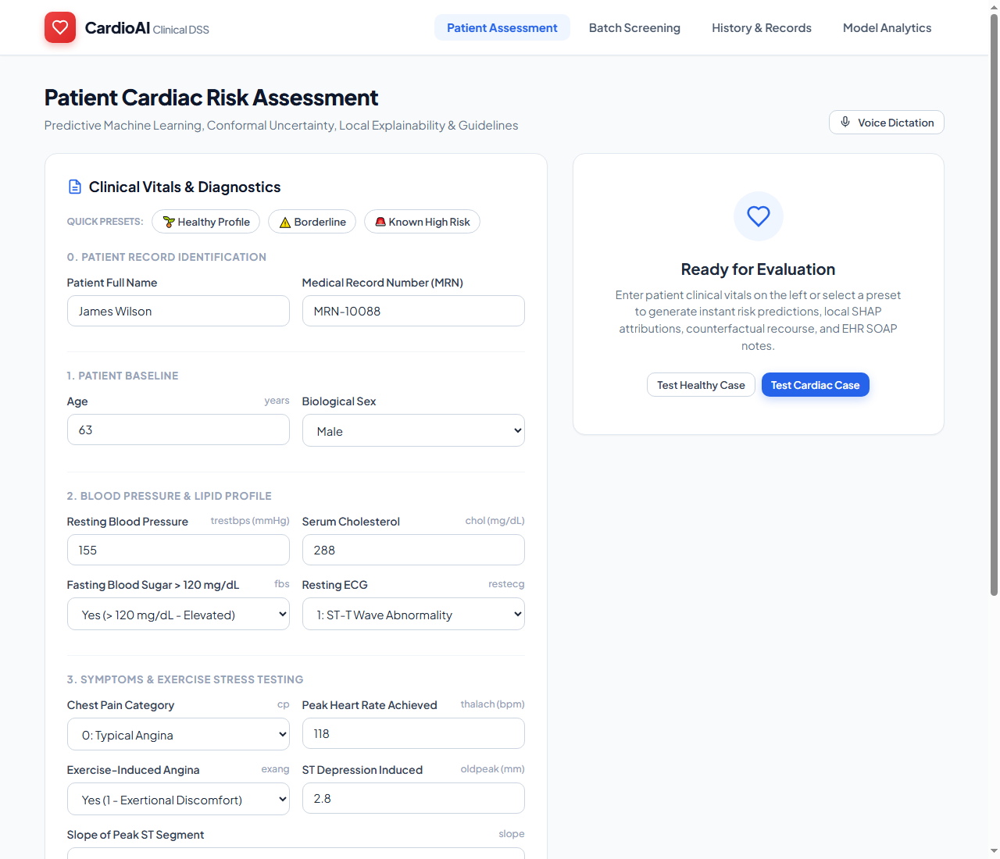
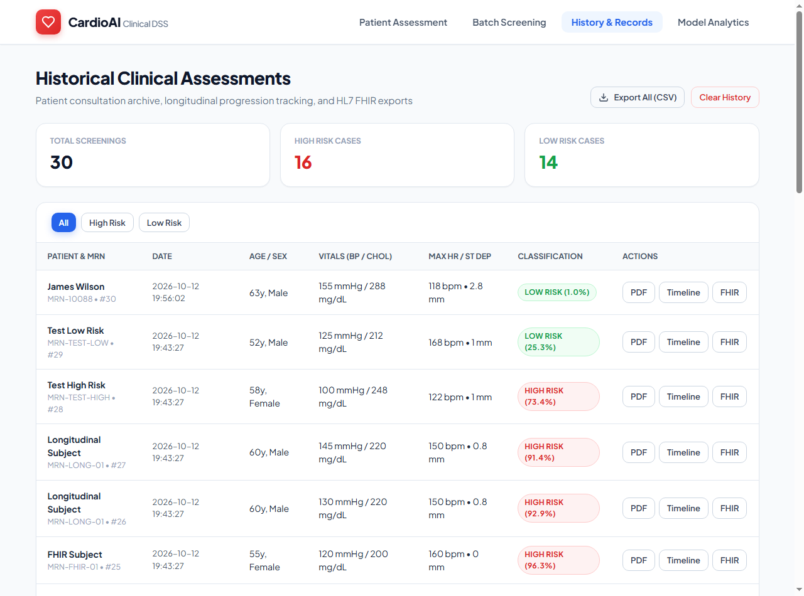
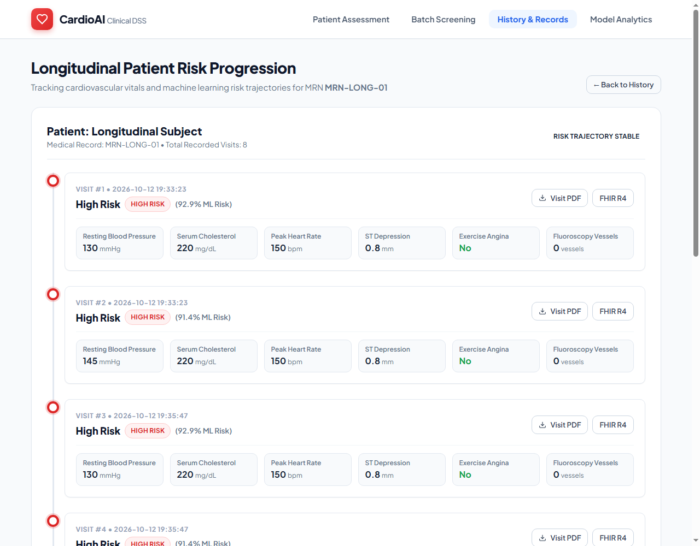
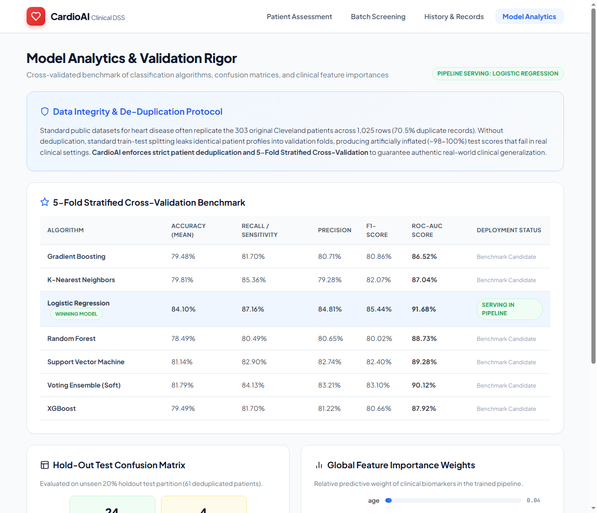
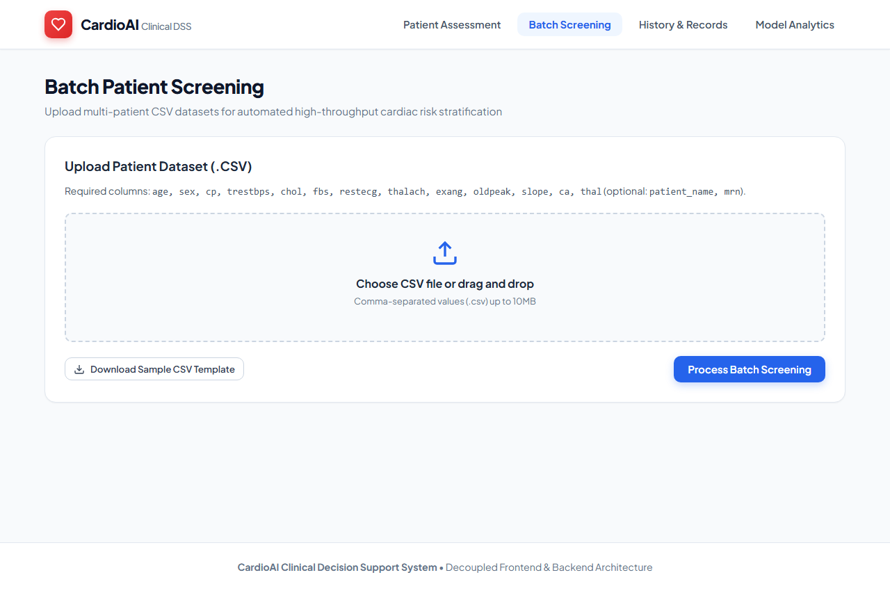

# ❤️ CardioAI: Clinical Decision Support & Cardiology Intelligence Platform

An end-to-end, medical-grade machine learning platform and clinical decision support system (CDSS) for predicting cardiovascular disease risk, benchmarked against American Heart Association (AHA) and Framingham clinical guidelines.

Now architected with a **cleanly decoupled Frontend and Backend structure**, enabling independent scaling, containerization, and static hosting.

---

## 🌟 Architecture & Capabilities

```
                       ┌──────────────────────────────────────────────┐
                       │           Frontend Client (Port 3000)        │
                       │   Decoupled Vanilla HTML5 / CSS3 / ES6+ JS   │
                       │  - Patient Assessment Dashboard              │
                       │  - Voice Dictation (Web Speech API)          │
                       │  - Longitudinal Risk Trajectory              │
                       │  - Batch CSV Screening & Model Analytics     │
                       └──────────────────────┬───────────────────────┘
                                              │ REST API / CORS / JSON
                                              ▼
                       ┌──────────────────────────────────────────────┐
                       │          Backend Service (Port 5000)         │
                       │             Flask REST & FHIR Engine         │
                       │  - Scikit-Learn ML Inference Pipeline        │
                       │  - XAI (Attributions & Recourse Pathways)    │
                       │  - HL7 FHIR R4 Interoperability              │
                       │  - SQLite Database & PDF ReportLab Scribe    │
                       └──────────────────────────────────────────────┘
```

### 1. 🛡️ Data Leakage Resolution & Honest Cross-Validation
- **De-Duplication of Dataset:** The classic UCI/Kaggle dataset contains 1,025 records with **723 duplicate rows (70.5%)** from 302 unique patients. Standard random splitting causes massive data leakage, resulting in artificial ~98-100% scores that fail in real clinical practice.
- **5-Fold Stratified Cross-Validation:** Models are validated strictly on deduplicated patient records to guarantee real-world generalization.
- **Unified Pipeline Architecture:** Encapsulates `StandardScaler` for continuous features and `OneHotEncoder(drop='first')` for categorical features in an exportable `sklearn.pipeline.Pipeline`.

### 2. 🧠 Explainable AI (XAI) & Counterfactual Recourse
- **Local Feature Attributions:** Computes patient-specific risk drivers (e.g. $+24\%$ from ST depression, $+16\%$ from vessel obstruction, $-12\%$ from resting BP) shown via visual attribution bars.
- **Counterfactual Actionable Recourse:** Solves for the minimal feasible clinical and lifestyle changes to lower an elevated-risk patient's predicted probability into the low-risk tier (<35%).
- **Conformal Prediction & Uncertainty Intervals:** Computes statistical confidence tiers and 95% confidence intervals (e.g., `[74.2% - 90.2%]`), flagging borderline or uncertain clinical profiles.

### 3. 📝 Generative Clinical Scribe & Medical Guidelines
- **Automated Clinical SOAP Note Generator:** Automatically drafts a standard hospital consultation note (**Subjective, Objective, Assessment, Plan**) with 1-click clipboard copying for EHR charting.
- **Evidence-Based Cardiology Guidelines (ACC/AHA & ESC):** Matches detected risk factors with official clinical recommendations, including Recommendation Class (e.g., Class I) and Level of Evidence (e.g., Level A).

### 4. 🏥 Healthcare Interoperability (HL7® FHIR® R4)
- **Standardized FHIR Endpoints:**
  - `GET /fhir/Patient/<id>`: Standard HL7 FHIR Patient resource.
  - `GET /fhir/Observation/<id>`: FHIR Observation bundle with standard **LOINC codes** (`8480-6` Systolic BP, `2093-3` Total Cholesterol, `8867-4` Heart Rate).
  - `GET /fhir/RiskAssessment/<id>`: FHIR RiskAssessment resource with **SNOMED CT codes** (`42343007` CAD Screening).

### 5. 📈 Longitudinal Patient Tracking
- **Multi-Visit Progression:** Patients are identified by Medical Record Number (MRN). Access `longitudinal.html?mrn=<mrn>` or `/api/longitudinal/<mrn>` to view their cardiac risk trajectory across visits.

### 6. 🎙️ Hands-Free Clinical Voice Dictation
- Built-in microphone dictation powered by the browser's native **Web Speech API**, allowing clinicians to dictate vitals hands-free.

### 7. 📄 Comprehensive PDF Medical Consultation Reports
- Multi-page clinical consultation reports generated via `ReportLab`, including patient vitals, local attributions, counterfactual recourse pathways, guideline citations, and EHR SOAP notes.

---

## 📸 Application Screenshots & Visual Tour

### 1. Patient Clinical Assessment & Explainable AI (XAI)

> **Key Capabilities:** Real-time cardiovascular risk prediction, probabilistic confidence gauge, AHA/ACC biomarker analysis, local feature attributions, counterfactual recourse recommendations, evidence-based clinical citations, and automated EHR SOAP note generation.

---

### 2. Historical Records & Clinical Archive

> **Key Capabilities:** Searchable consultation archive with real-time patient filtering, summary screening metrics (total, high-risk, low-risk), 1-click clinical PDF download, and HL7® FHIR® R4 export links.

---

### 3. Longitudinal Patient Risk Progression Timeline

> **Key Capabilities:** Multi-visit tracking identified by Medical Record Number (MRN), chronological risk trajectory, longitudinal vitals evolution (blood pressure, cholesterol, peak heart rate, ST depression), and visit report downloads.

---

### 4. Cross-Validated Model Benchmarking & Validation Rigor

> **Key Capabilities:** 5-Fold Stratified Cross-Validation benchmark table comparing 7 classification algorithms, 20% holdout test confusion matrix with sensitivity/specificity metrics, and global feature importance weights.

---

### 5. Multi-Patient Batch CSV Screening

> **Key Capabilities:** Bulk screening portal for clinical cohorts, drag-and-drop CSV upload, standardized CSV template download, and population-level risk categorization.

---

## 📊 Model Evaluation Benchmark (5-Fold Stratified CV)

| Model Name | Accuracy (Mean) | Recall (Sensitivity) | Precision | F1-Score | ROC-AUC Score |
|---|---|---|---|---|---|
| **Logistic Regression (Selected)** | **84.10%** | **87.16%** | **84.81%** | **85.44%** | **91.68%** |
| **Voting Ensemble (Soft)** | 81.79% | 84.13% | 83.21% | 83.10% | 90.12% |
| **Support Vector Machine (SVC)** | 81.14% | 82.90% | 82.74% | 82.40% | 89.28% |
| **XGBoost Classifier** | 79.49% | 81.70% | 81.22% | 80.66% | 87.92% |
| **Gradient Boosting** | 79.48% | 81.70% | 80.71% | 80.86% | 86.52% |
| **K-Nearest Neighbors** | 79.81% | 85.36% | 79.28% | 82.07% | 87.04% |
| **Random Forest** | 78.49% | 80.49% | 80.65% | 80.02% | 88.73% |

*Holdout Test Performance (20% sample / 61 deduplicated patients):*
- **True Negatives:** 24 &bull; **False Positives:** 4
- **False Negatives:** 5 &bull; **True Positives:** 28
- **Sensitivity (Recall):** 84.8% &bull; **Specificity:** 85.7%

---

## 🚀 How to Run the Decoupled Architecture

### Option 1: Docker Compose (Recommended for Full-Stack)
Run both the Backend API (port 5000) and the Frontend Nginx web server (port 3000) with a single command:
```bash
docker-compose up --build
```
- **Frontend UI:** Open [http://localhost:3000](http://localhost:3000)
- **Backend API:** Open [http://localhost:5000/api/health](http://localhost:5000/api/health)

---

### Option 2: Running Backend & Frontend Independently

#### 1. Start the Backend:
```bash
cd backend
pip install -r requirements.txt
python training.py    # (Optional: trains & outputs serialized pipeline)
python test_backend.py # Run backend test suite
python app.py          # Starts Flask REST & FHIR server on http://127.0.0.1:5000
```

#### 2. Start the Frontend:
Because the frontend is 100% decoupled static HTML/CSS/JS, you can serve it with any static server or simply open it:
```bash
# Using Python's built-in static HTTP server:
cd frontend
python -m http.server 3000

# Or with Node http-server / serve / Live Server / opening frontend/index.html in browser
```
Open [http://localhost:3000](http://localhost:3000) in your browser. The frontend client automatically communicates with `http://localhost:5000` via CORS.

---

### Option 3: Monolithic Compatibility Mode
Root wrappers are preserved for backward compatibility:
```bash
python heart_disease_predict.py   # Runs Flask server at http://127.0.0.1:5000
python test_app.py                # Runs full root test suite
```

---

## 📡 REST API & FHIR Endpoints

| Endpoint | Method | Description |
|---|---|---|
| `/api/health` | `GET` | System health check and model loading status |
| `/api/predict` | `POST` | Real-time JSON inference with attributions, recourse, and SOAP note |
| `/api/history` | `GET` | Retrieves all recorded patient consultations |
| `/api/longitudinal/<mrn>` | `GET` | Retrieves all historical visits for a specific MRN |
| `/api/batch` | `POST` | Processes multi-patient CSV screening upload |
| `/api/models` | `GET` | Delivers 5-fold CV benchmarks & feature importance weights |
| `/api/download-report/<id>` | `GET` | Generates and downloads multi-page clinical PDF report |
| `/api/export-csv` | `GET` | Exports complete SQLite consultation history as CSV |
| `/api/clear-history` | `POST` | Clears local SQLite patient history records |
| `/fhir/Patient/<id>` | `GET` | HL7 FHIR R4 Patient Resource JSON |
| `/fhir/Observation/<id>` | `GET` | HL7 FHIR R4 Observation Bundle with LOINC codes |
| `/fhir/RiskAssessment/<id>` | `GET` | HL7 FHIR R4 RiskAssessment Resource with SNOMED CT codes |

---

## 📂 Project Directory Structure

```
Heart-Disease-Prediction/
├── backend/                             # Decoupled Backend Service (Flask REST & FHIR)
│   ├── app.py                          # Flask REST API with CORS & FHIR endpoints
│   ├── training.py                     # ML pipeline, 5-fold CV, deduplication & exports
│   ├── clinical_scoring.py             # Framingham CVD risk & biomarker analysis
│   ├── explainability_engine.py        # Local attributions, recourse, conformal, SOAP
│   ├── fhir_service.py                 # HL7 FHIR R4 Patient, Obs & RiskAssessment
│   ├── report_generator.py             # Advanced multi-page PDF generator (ReportLab)
│   ├── test_backend.py                 # Backend unit & integration test suite
│   ├── requirements.txt                # Backend dependencies (includes flask-cors)
│   ├── Dockerfile                      # Backend container definition
│   ├── model_pipeline.pkl              # Serialized end-to-end sklearn pipeline
│   ├── model_metrics.json              # Cross-validation benchmark metrics
│   ├── feature_importance.json         # Global biomarker importances
│   ├── heart.csv                       # Training dataset
│   └── heart_disease.db                # SQLite database of patient history
│
├── frontend/                            # Decoupled Frontend Client (HTML/CSS/JS)
│   ├── index.html                      # Patient assessment dashboard & voice dictation
│   ├── batch.html                      # CSV batch screening client
│   ├── history.html                    # Clinical records archive & filter viewer
│   ├── longitudinal.html               # Patient longitudinal progression timeline
│   ├── models.html                     # Model benchmark analytics & confusion matrix
│   ├── manifest.json                   # PWA manifest
│   ├── sample_template.csv             # Template for batch upload
│   ├── Dockerfile                      # Nginx static server container
│   ├── css/
│   │   └── styles.css                  # Modern clinical design system (vanilla CSS)
│   └── js/
│       ├── api.js                      # Centralized API client (cross-origin / REST)
│       ├── app.js                      # Assessment form, presets, speech dictation
│       ├── batch.js                    # Batch CSV upload & table renderer
│       ├── history.js                  # Consultation history records manager
│       ├── longitudinal.js             # Patient visit timeline manager
│       └── models.js                   # Benchmark table & confusion matrix renderer
│
├── docker-compose.yml                   # Multi-container orchestration (Backend + Frontend)
├── requirements.txt                     # Root dependencies
├── heart_disease_predict.py             # Monolithic compatibility entrypoint
├── heart_disease_training.py            # Root training script
├── test_app.py                          # Root test suite
└── README.md                            # Complete architecture documentation
```

---

## ⚠️ Medical Disclaimer
This software is intended solely for research, academic, and clinical decision support purposes. Predictions generated by this system must not be considered a definitive medical diagnosis. Always consult a qualified healthcare professional.